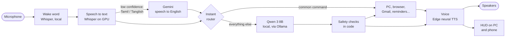

<div align="center">

# Keena

**A voice AI companion that lives on your Windows PC.**
Talk to her in English, Tamil or Tanglish. She answers in a natural voice, remembers what matters to you,
and actually gets things done on your computer.


-E8338A)


[Features](#features) · [Requirements](#system-requirements) · [Quick start](#quick-start) ·
[How it works](#how-it-works) · [Configuration](#configuration) · [Privacy](#privacy-and-data) ·
[Troubleshooting](#troubleshooting) · [Full setup guide](docs/SETUP.md)

</div>

---

## Overview

Keena is an open-source personal assistant built around a **local large language model** (Qwen 3 8B, served by
[Ollama](https://ollama.com)) running on your own graphics card. There is no subscription and no cloud chatbot behind
her: the reasoning happens on your machine. Around that brain sit an instant command router, a set of PC and browser
tools, a memory store, a safety layer enforced in code, a pink arc-reactor HUD, and a phone remote.

> Say **"Hey Keena"**, wait for the soft chime, and talk. After she answers, keep talking for a few seconds without
> repeating her name.

## Features

| Area | What she does | Example |
|---|---|---|
| **Conversation** | Warm, playful companion; encourages you on a rough day; honest when she doesn't know | "I had a rough day." |
| **Multilingual input** | Understands English, Tamil and Tanglish; always replies in English | "Vijay oda nalla padam suggest pannu" |
| **PC control** | Apps, volume, media keys, screenshots, lock / sleep (with confirmation), typing, dictation | "Volume 30", "take a screenshot" |
| **Music** | Plays the first matching YouTube video; pause, next, close the tab | "Play Believer" |
| **Web answers** | Searches the web, reads the top pages, answers in 1-3 sentences and names the source | "What's the latest on the RBI repo rate?" |
| **Recommendations** | Two or three real picks from the web, then her favourite | "Suggest a good Rajinikanth movie" |
| **Shopping** | Drives her own Chrome window: search, open the cheapest / best-rated result, read the price, add to cart | "Search Amazon for a gaming mouse and open the cheapest one" |
| **Email** | Opens Gmail, types the mail live, asks before sending | "Draft a mail to Arjun about the demo and send it" |
| **Memory** | Remembers only what you ask; recalls and forgets on request; summarises past conversations | "Remember that my gym is at 6 AM" |
| **Reminders** | Reminders, timers and notes, announced on time | "Remind me to call mom at 6 PM" |
| **Phone remote** | A private web app on your phone with the same HUD and hands-free "Hey Keena" | Pair once with a QR code |
| **HUD** | Animated corner orb showing state, actions and the sentence being spoken; full-screen mode | "Big screen mode" |

## System requirements

Keena's brain (about 5.6 GB) and her speech recognition (about 0.5-1 GB) run **on the graphics card at the same time**.
On an 8 GB card roughly 6.8 GB is in use, which is why 8 GB of VRAM is the practical minimum.

| Component | Minimum | Recommended |
|---|---|---|
| Operating system | Windows 10 / 11, 64-bit | Windows 11 |
| Graphics card | **NVIDIA RTX, 8 GB VRAM** (RTX 2070/2080, 3060 8 GB, 3060 Ti, 3070, 4060, 4060 Ti) | NVIDIA, 12 GB+ VRAM (RTX 3060 12 GB, 4070 or better) |
| Memory (RAM) | 16 GB | 32 GB |
| Processor | 6 cores (Intel Core i5 10th gen / AMD Ryzen 5 3600) | 8 cores or more |
| Storage | 20 GB free, SSD | 40 GB free, SSD |
| Software | Python 3.11, Ollama, Google Chrome, Git | |
| Peripherals | Microphone and speakers | Headset or USB microphone |
| Network | Internet connection (voice, web, Tamil) | Stable broadband |

**Not supported:** macOS and Linux (Keena automates Windows itself), AMD and Intel GPUs (speech recognition uses
NVIDIA CUDA). Cards with 6 GB can run the smaller `qwen3:4b-instruct` model with reduced quality.

## Quick start

> The complete walkthrough, with a verification check after every step, is in **[docs/SETUP.md](docs/SETUP.md)**
> (also available as a [PDF](docs/Keena_Setup_Guide.pdf)).

**1. Prerequisites:** the latest NVIDIA driver, [Python 3.11](https://www.python.org/downloads/) (tick *Add python.exe
to PATH*), [Git](https://git-scm.com), [Google Chrome](https://www.google.com/chrome/) and [Ollama](https://ollama.com).

**2. Download the model and the code**

```powershell
ollama pull qwen3:8b
git clone https://github.com/WeDigiStudio/Keena-Personal-Assistant.git keena
cd keena
```

**3. Install**

```powershell
py -3.11 -m venv .venv
.venv\Scripts\activate
pip install -r requirements.txt
pip install nvidia-cublas-cu12 "nvidia-cudnn-cu12==9.*"
```

**4. Configure**

```powershell
copy .env.example .env
notepad .env
```

Set `JARVIS_USER` to your name. Optionally add the two free API keys described under [Configuration](#configuration),
and create an `about_me.txt` profile (one fact per line, for example `City: Chennai`).

**5. Run**

```powershell
python main.py --text      # type to her first: checks the brain and tools
python main.py             # voice mode: say "Hey Keena"
```

## How it works



1. **Wake word.** Short audio segments are transcribed locally and checked for her name.
2. **Speech recognition.** Whisper (`small.en`) transcribes on the GPU in about 0.1-0.3 s. When Whisper's confidence is
   low, which is how Tamil speech appears to an English-only model, the same audio is sent to Gemini for an English
   rendering. English speech never leaves the PC.
3. **Instant router.** Common commands are matched by rules and executed without calling the model.
4. **Reasoning.** Conversation goes to a companion prompt with her personality; requests that need tools go to the
   tool-calling model. Recommendations and live facts are grounded in web search results.
5. **Safety layer.** Every reply is checked in code before it is spoken or acted on (see [Safety](#safety)).
6. **Voice and HUD.** Replies are synthesised sentence by sentence so speech starts early; the HUD shows the sentence
   being spoken, at speaking pace.

Typical latency on an RTX 4060: instant commands about 1 s end to end, first spoken word of a chat reply about 1.5 s,
web answers 2-4 s; Tamil input adds 2-3 s.

## Configuration

All settings live in `.env` (copied from [`.env.example`](.env.example)). Restart Keena after changing them.

<details>
<summary><b>Identity and voice</b></summary>

| Variable | Default | Description |
|---|---|---|
| `JARVIS_USER` | `friend` | Your name; she addresses you by it |
| `ASSISTANT_NAME` | `Keena` | Her name, also used as the wake word |
| `JARVIS_VOICE` | `en-US-AvaNeural` | Any Edge neural voice (`en-US-EmmaNeural`, `en-IN-NeerjaNeural`, `en-GB-SoniaNeural`...) |
| `VOICE_RATE` | `+0%` | Speaking speed, e.g. `+8%` or `-5%` |
| `JARVIS_CITY` | `Chennai` | Default city for weather |

</details>

<details>
<summary><b>Brain and hearing</b></summary>

| Variable | Default | Description |
|---|---|---|
| `JARVIS_MODEL` | `qwen3:8b` | Ollama model; `qwen3:4b-instruct` for smaller cards |
| `OLLAMA_HOST` | `http://127.0.0.1:11434` | Ollama address (keep 127.0.0.1, not localhost) |
| `CONTEXT_TOKENS` | `4096` | Model context size |
| `USE_MMAP` | `0` | `0` keeps the model out of system RAM |
| `WHISPER_MODEL` | `small.en` | Speech recognition model |
| `WHISPER_DEVICE` | `cuda` (in the example file) | `cuda` for the GPU, `cpu` as a fallback |
| `WAKE_MODE` | `whisper` | `whisper`, `model` or `both` |
| `FOLLOW_UP_SECONDS` | `6` | How long she keeps listening after replying |
| `SILENCE_RMS` | `500` | Microphone level that counts as speech |
| `SILENCE_SECONDS` | `0.7` | Pause that ends your sentence |
| `MIC_DEVICE` | *(empty)* | Microphone index or name; empty = Windows default |
| `HEAR_NAMES` | *(empty)* | Names she should recognise (people, companies), comma separated |

</details>

<details>
<summary><b>Online services (optional, free)</b></summary>

| Variable | Description | Get it from |
|---|---|---|
| `LANGSEARCH_API_KEY` | Web answers and recommendations | [langsearch.com](https://langsearch.com) |
| `GEMINI_API_KEY` | Understanding Tamil and Tanglish speech | [aistudio.google.com](https://aistudio.google.com) |
| `TAMIL_MODEL` | Gemini model used for that (default `gemini-3.1-flash-lite`) | |
| `KNOWN_EMAIL_DOMAINS` | Your email domains, so spoken addresses are corrected | |

</details>

<details>
<summary><b>Browser, phone remote and HUD</b></summary>

| Variable | Default | Description |
|---|---|---|
| `BROWSER_CONTROL` | `1` | Open pages in Keena's own Chrome window so she can act on them |
| `BROWSER_PORT` | `9229` | Chrome DevTools port for her window |
| `CHROME_PATH` | *(auto)* | Path to `chrome.exe` if it isn't found automatically |
| `REMOTE` | `1` | Phone remote server |
| `REMOTE_PORT` / `REMOTE_HTTPS_PORT` | `8765` / `8766` | Phone remote ports (HTTPS is needed for the phone microphone) |
| `REMOTE_LAN` | `1` | Allow phones on your home network (Tailscale is always allowed) |
| `REMOTE_SPEAK` | `0` | Also speak phone replies on the PC |
| `HUD` | `1` | Show the on-screen orb |
| `HUD_POSITION` | `bottom-right` | Corner for the HUD |
| `HUD_SCALE` | `1.0` | HUD size (0.6-2.0) |
| `FILLERS` | `1` | "One moment..." while she thinks |
| `LIVE_TRANSCRIPT` | `auto` | Show your words live while you speak |

</details>

<details>
<summary><b>Memory and behaviour</b></summary>

| Variable | Default | Description |
|---|---|---|
| `LOG_CONVERSATIONS` | `1` | Keep a local conversation log in `data/jarvis.db` |
| `OFFER_REMINDERS` | `1` | Offer reminders when you mention plans with a time |

</details>

## Phone remote

```powershell
python -m remote.pair
```

Scan the QR code on a phone connected to the same Wi-Fi. Because the PC issues its own certificate, the browser shows a
*connection is not private* warning once: choose **Advanced → Proceed**. Allow the microphone and add the page to your
home screen. Tap the reactor once (browsers require a tap before audio), then speak hands-free. For access outside your
home network, sign in to [Tailscale](https://tailscale.com) on both devices.

## Privacy and data

| Stays on your PC | Uses an online service |
|---|---|
| Language model and all reasoning (Qwen 3 8B) | Voice synthesis: reply text is sent to Microsoft's Edge TTS |
| English speech recognition and wake word (Whisper) | Web answers and recommendations: queries to LangSearch |
| Memories, profile, conversation log (`data/`, `about_me.txt`) | Tamil / Tanglish speech: audio sent to Google Gemini, only when used |
| PC and browser control, HUD, phone server | Websites she opens on your behalf |

`.env`, `about_me.txt` and `data/` are excluded by `.gitignore`. Never commit or share them: they contain your keys,
your profile, your memories and the browser profile with your logins.

## Safety

Safety rules are enforced in code, not only in prompts:

- **Confirmation required** before sending an email, buying or paying, shutting down, restarting or sleeping the PC.
- **No invented facts.** Dates, numbers and personal details in replies must come from your profile, memory or your
  words; recommendations must come from web results. Fake claims of having done something are blocked.
- **No invented addresses or times.** Email recipients and reminder times must come from you.
- **Memory on request only.** She saves facts only when asked, and forgets on request.
- **No typing into terminals**, so an accidental newline can never run a command.
- **Phone access** requires a secret pairing key and is limited to your network or your Tailscale devices.

## Troubleshooting

| Symptom | Resolution |
|---|---|
| *Can't reach Ollama* | Start Ollama from the Start menu, then run Keena again. |
| Slow replies, or `ollama ps` shows CPU | Not enough free VRAM: close games and GPU-heavy apps. |
| She never hears "Hey Keena" | Run `python main.py --mic-test`, set `MIC_DEVICE`, adjust `SILENCE_RMS`. |
| She cuts you off / keeps listening | Raise or lower `SILENCE_RMS` and `SILENCE_SECONDS`. |
| No voice, or *Voice error 403* | Check the internet connection; run `pip install -U edge-tts`. |
| Whisper GPU errors at startup | Reinstall `nvidia-cublas-cu12` and `nvidia-cudnn-cu12` (Quick start, step 3). |
| Gmail shows a Google sign-up page | Sign in to Gmail once in Keena's own Chrome window. |
| *Web search isn't set up* | Add `LANGSEARCH_API_KEY` to `.env`. |
| Tamil isn't understood | Add `GEMINI_API_KEY` to `.env`; free keys have a daily limit. |
| Phone can't connect | Same Wi-Fi as the PC; allow Python through Windows Firewall; run `python -m remote.pair` again. |

More in [docs/SETUP.md](docs/SETUP.md#troubleshooting).

## Project structure

```
keena/
├── main.py              Voice loop: wake word, listening, follow-ups, timing, HUD states
├── config.py            All settings, read from .env
├── hud.py               PySide6 arc-reactor HUD (separate process, UDP)
├── brain/
│   ├── router.py        Instant command patterns and small talk (no model call)
│   ├── brain.py         Tool-calling model, web answers, recommendations, safety guards
│   ├── companion.py     Conversation, personality and honesty checks
│   ├── persona.py       Her character and instant reply lines
│   ├── memory.py        Facts you asked her to remember (SQLite)
│   ├── summaries.py     Summaries of past conversations
│   └── emails.py        Spoken email addresses to real ones
├── tools/
│   ├── pc_tools.py      PC control and the tool registry
│   ├── browser.py       Keena's own Chrome window (Playwright): shopping, Gmail, page reading
│   ├── extras.py        Reminders, notes, weather, Wikipedia, files, calculator
│   ├── web.py           Web search
│   └── apps.py          Installed app and game finder
├── voice/
│   ├── stt.py           Whisper speech recognition and wake-word detection
│   ├── language.py      Tamil / Tanglish understanding
│   ├── tts.py           Neural voice, streamed sentence by sentence
│   └── audio.py, wake.py, hud_client.py
├── remote/              Phone remote: server, web app, QR pairing
├── scripts/             Autostart with Windows
└── docs/                Setup guide (Markdown and PDF)
```

## FAQ

**Is it free?** Yes. The model, Ollama, Whisper and this code are free; the voice service and both API keys have free
tiers. You need suitable hardware.

**Does it use ChatGPT?** No. The language model runs locally on your GPU.

**Can I rename her or change her voice?** Yes: `ASSISTANT_NAME` and `JARVIS_VOICE` in `.env`.

**Why does she reply in English when I speak Tamil?** Spoken Tamil from small local models was not good enough, so she
understands Tamil and answers in English by design.

**Will it run on a laptop?** Yes, with an NVIDIA RTX GPU with 8 GB of VRAM and 16 GB of RAM. Keep it plugged in.

## Acknowledgements

Built with [Ollama](https://ollama.com) and [Qwen 3](https://github.com/QwenLM/Qwen3),
[faster-whisper](https://github.com/SYSTRAN/faster-whisper), [edge-tts](https://github.com/rany2/edge-tts),
[Playwright](https://playwright.dev), [PySide6](https://doc.qt.io/qtforpython-6/) and
[openWakeWord](https://github.com/dscripka/openWakeWord).

## License

Released under the [MIT License](LICENSE).
